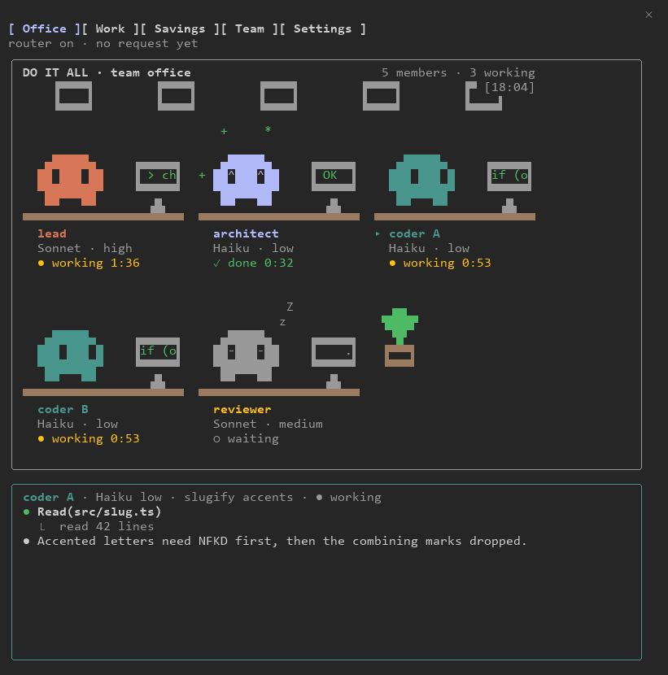
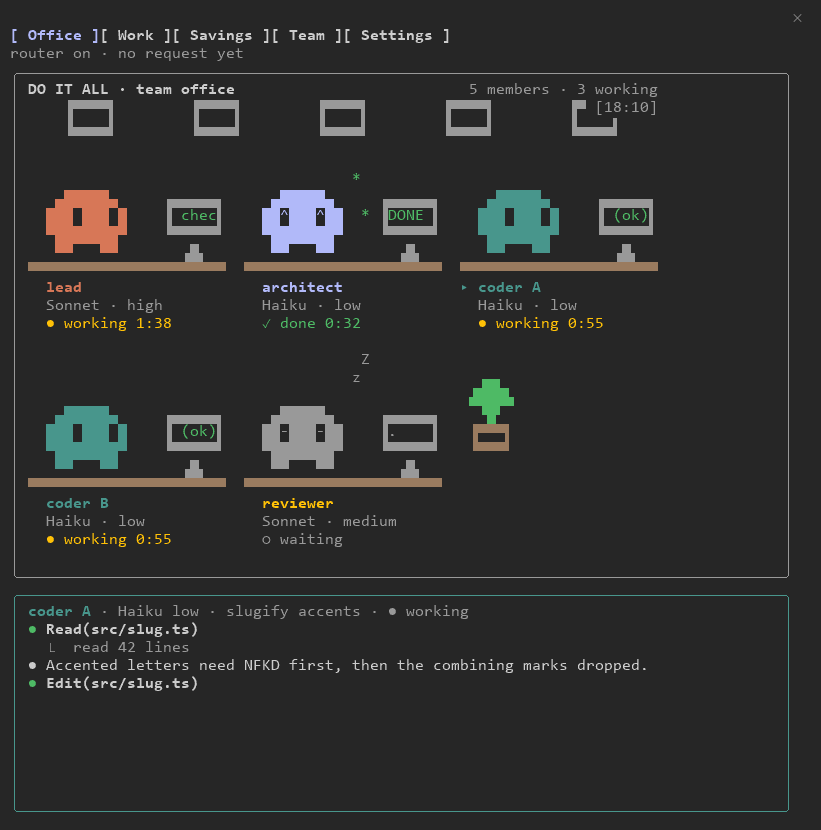

# Do It All Claude Code

[](https://github.com/ggreing/do-it-all-claude-code/actions/workflows/ci.yml)


[](LICENSE)

[English](README.md) · [한국어](README.ko.md) · [日本語](README.ja.md) · [简体中文](README.zh-CN.md)

Claude Code를 Opus나 Sonnet으로 쓰면 메인 세션이 거의 모든 일을 직접 합니다. 훨씬 싼 모델도 충분히
해낼 수정까지 전부요. 이 프로젝트는 그걸 바꾸는 Claude Code 플러그인과 작은 로컬 데몬입니다.
요청이 들어올 때마다 메인 세션이 그냥 처리할지, 아니면 싼 모델로 도는 서브에이전트 몇 개에게 일을
맡기고 메인 세션은 계획과 확인만 할지를 정합니다.

측정 결과와 측정 방법은 [docs/measurements](docs/measurements/)에 있습니다.

<p align="center"></p>

CLI와 패키지 이름은 `do-it-all-claude-code`입니다.

## 어떻게 동작하나

플러그인이 Claude Code의 훅 이벤트를 `127.0.0.1`의 데몬으로 넘깁니다. 프롬프트를 보내면 데몬이
모델 호출 없이 규칙만으로 요청의 크기를 가늠하고, 메인 세션(여기서는 '총괄'이라고 부릅니다)에게 직접
처리할지 팀에 맡길지 알려 줍니다.

오타나 한 줄 수정 같은 작은 일은 총괄이 그냥 합니다. 그보다 큰 일은 총괄이 Opus급이나 Sonnet이면,
또는 어떤 모델인지 알 수 없으면 팀에 맡깁니다. 총괄이 Haiku라면 L1 정도는 직접 합니다. 어차피 작업자도
같은 모델이라 넘겨 봐야 이득이 없거든요. 규칙으로 크기를 판단하기 어려운 요청은 작은 팀으로 보내고,
어떤 역할이 실제로 필요한지는 총괄이 고릅니다(Haiku 총괄은 짧은 판단 기준을 받아 직접 정합니다).

작업자는 보통 통하는 가장 싼 단계에서 시작하고(코더라면 Haiku, effort low), 실패하면 올라갑니다.
연속 두 번 실패하거나, 검토자나 테스터에게 두 번 거부당하거나, 총괄이 요청하면 한 단계 올립니다.
반대로 검토자에게 '여유 있음' 판정을 연달아 받으면 한 단계 내려갑니다. 세 번 올라갔는데도 안 되면
사용자에게 묻습니다.

작업자가 일을 끝내면 데몬이 그 작업 폴더에서 프로젝트의 빌드, 타입 검사, 린트, 테스트를 돌리고,
작업자가 맡은 파일 범위 안에서만 고쳤는지 확인합니다. 무엇을 계획했고 실제로 어떻게 됐고 얼마가
들었는지는 전부 로컬 SQLite 파일 하나에 남습니다.

데몬이 꺼져 있으면 Claude Code는 플러그인이 없는 것처럼 동작합니다. 예외는 라우터 작업자입니다.
작업자는 데몬이 켜져 있을 때만 파일을 쓸 수 있어서, 맡은 범위 밖을 고치는 일이 생기지 않습니다.

## 시작하기

Node 24.5 이상, Claude Code 2.1.325 이상이 필요하고, Windows라면 Git Bash도 있어야 합니다(Claude Code
자체가 요구합니다).

Windows에서는 Claude Code를 **Windows Terminal**에서 실행하세요. 기본 콘솔 창은 팀 사무실 캐릭터를
그리지 못해 목록처럼 보입니다. 기본으로 지정: Windows Terminal → 설정 → 시작 → 기본 터미널 애플리케이션
→ Windows 터미널(또는 Windows 설정 → 시스템 → 고급(이전 버전은 개발자용) → 터미널). 그러면 PowerShell을 열어도 Windows
Terminal 안에서 열립니다.

들어가는 길은 두 가지입니다.

**한 줄(npm).** 플러그인과 상태 라인을 깔고, 데몬을 띄우고, 기본으로 Claude 구독에서 라우팅합니다:

```
npx do-it-all-claude-code setup
```

(또는 `npm i -g do-it-all-claude-code` 뒤 `do-it-all-claude-code setup`.) 그다음 `claude`를 실행하세요.
`/office demo`로 팀 사무실을 미리 볼 수 있습니다.

**Claude Code 안에서.** 세션에서 시작하고 싶다면:

```
/plugin marketplace add ggreing/do-it-all-claude-code
/plugin install do-it-all-claude-code@do-it-all
/do-it-all-setup
```

앞 두 줄이 플러그인을 설치하고, `/do-it-all-setup`이 엔진을 라우터 홈에 깔고 데몬을 띄웁니다.

데몬은 Claude Code 세션이 시작될 때 스스로 뜹니다(`do-it-all-claude-code config set autoStart off`로 끕니다).
뭔가 이상하면 `do-it-all-claude-code doctor`로 점검하세요. 소스에서(기여자): 클론 후 `npm ci`, 그다음
`node packages/cli/src/index.ts setup`.

자주 쓸 명령은 이 정도입니다.

| 명령 | 하는 일 |
|---|---|
| `status`, `stop` | 데몬 상태 보기, 끄기 |
| `mode subscription\|api\|direct\|proxy` | 모드 바꾸기 (아래 참고) |
| `policy show\|accept` | 프로젝트의 `.do-it-all-claude-code/policy.json`을 확인하고 적용 승인 |
| `data export`, `data purge` | 라우터가 기록한 내용 내보내기, 지우기 |
| `uninstall` | `init`이 한 일 되돌리기 (데이터 폴더는 남음) |

## 구독으로 쓸 때, API 키로 쓸 때

기본은 Claude 구독입니다. 이 모드에는 프록시가 없고, 라우터는 구독 자격증명을 읽지도 저장하지도
않습니다. Claude Code는 지금처럼 Anthropic과 직접 통신합니다.

API 키로 쓰려면 `do-it-all-claude-code init --mode api`를 실행하세요. API 앞에 작은 로컬 프록시가 붙어서 호출마다
실제 토큰 비용을 기록하고 하루 예산을 적용합니다. 기본값은 로컬 토큰당 하루 $100, 전체 하루 $300입니다.
요청마다 최악의 경우(프롬프트 크기와 `max_tokens`를 그 모델의 최고 요율로 계산한 값)를 이 상한에 걸어 두고
요청이 끝날 때까지 유지하며, 그 몫이 들어가지 않으면 요청을 시작하지 않습니다. 그래도 이 예약이 덮는 것은
요청 본문뿐입니다. API가 스스로 가져오는 것(아이디로 참조한 파일, URL로 참조한 이미지, 웹 검색 같은 서버
도구)은 본문에 없고 호출이 정산될 때 과금되므로, 하루가 상한을 조금 넘겨 끝날 수 있습니다. API 키는 OS
키체인에만 둡니다. 프록시가 거슬리면 `do-it-all-claude-code mode direct`로 우회하고, `do-it-all-claude-code mode proxy`로
되돌리면 됩니다.

**로컬 TLS.** API 키 모드에서 Claude Code는 `https://127.0.0.1:<port>`로 프록시에 연결하며, 이 라우터만
가진 인증서를 씁니다. `openssl`로 만들고 `127.0.0.1`과 `localhost`에만 유효하며 다른 사이트를 보증할 수
없고, 라우터 홈에 당신만 읽을 수 있게 둡니다. Claude Code는 설정의 `NODE_EXTRA_CA_CERTS`를 통해 이 인증서를
신뢰합니다. 인증서는 만료 전에 갱신되며, 갱신 중에 열려 있던 Claude Code 세션은 다시 시작해야 합니다.
`doctor`가 그 시점을 알려줍니다. 다른 프로그램이 프록시가 꺼진 사이 그 포트를 차지해도 TLS 핸드셰이크를 끝내지
못하므로 로컬 토큰도 프롬프트도 그쪽으로 가지 않습니다. 이미 `NODE_EXTRA_CA_CERTS`를 직접 쓰고 있다면(예:
회사 CA), 라우터가 당신의 인증서와 자기 인증서를 묶은 번들을 Claude Code 설정에 넣어 회사 CA도 계속
신뢰되게 하고, `mode direct`·`mode subscription`·`uninstall`은 당신의 원래 값을 되돌리며, `doctor`는 셸
변수도 그 번들을 가리키도록 제안합니다. `openssl`이 없으면 프록시는 같은 요청 점검을 유지한 채 평문 HTTP로
동작하고, `doctor`가 이를 알려줍니다.

**회사 프록시 뒤에서.** 프록시는 환경이 지정한 프록시를 통해 API에 닿습니다. `https_proxy`, `HTTPS_PROXY`,
`http_proxy`, `HTTP_PROXY` 중 처음 설정된 것(Claude Code가 쓰는 순서)을 쓰고 `NO_PROXY`를 존중합니다.
Node 내장 프록시 지원(Node 24.5 이상)을 쓰므로 HTTPS는 CONNECT 터널로 지나가고 API 인증서는 끝까지
검증됩니다. 프록시 URL에 든 자격증명은 프록시에만 가고 로그·오류·`doctor`에는 나타나지 않습니다. TLS를
들여다보는 프록시라면 그 루트 인증서를 Node가 신뢰해야 하며, 예를 들어 `NODE_EXTRA_CA_CERTS`로 지정합니다.
SOCKS는 지원하지 않고, 라우터가 쓸 수 없는 프록시 설정이면 프록시를 몰래 우회하는 대신 시작을 멈춥니다.

반대 방향으로, 그냥 두면 Claude Code가 `127.0.0.1:<port>`의 로컬 프록시로 보내는 자기 요청(로컬 토큰
포함)도 회사 프록시를 거치게 됩니다. 그래서 프록시가 설정돼 있으면 `do-it-all-claude-code init --mode api`와
`mode api`가 Claude Code 설정의 `NO_PROXY`에 `127.0.0.1`과 `localhost`를 더하고(기존 항목은 유지),
`mode direct`, `mode subscription`, `uninstall`은 자신이 더한 것만 뺍니다. `do-it-all-claude-code doctor`가 양쪽
방향을 모두 점검합니다.

## 작업자와 권한

라우터 작업자는 Claude Code의 일반 도구를 쓰되, 앞에 검사 단계(가드)가 붙습니다. 가드는 맡은 범위 밖
쓰기, 자격증명 파일이나 라우터 폴더 접근, 허용 목록 밖의 명령을 거부합니다. 대신 Bash를 사용자 대신
허락하지는 않습니다. 작업자의 `npm test`도 평소 Claude Code 권한 규칙을 그대로 따릅니다. 작업자가 매번
묻지 않고 빌드와 테스트를 돌리게 하려면 이렇게 허용해 두세요.

```
claude --allowedTools "Bash(npm test)" "Bash(npm run *)"
```

무엇이 왜 거부되는지 전체 목록은 [docs/worker-permissions.md](docs/worker-permissions.md)에 있습니다(영어).

## 데이터

모든 기록은 내 컴퓨터의 SQLite 파일 하나에만 남고, 라우터가 스스로 외부로 보내는 통신은 선택형 업데이트
확인(아래 '업데이트' 참고) 말고는 없습니다.
기본 설정에서는 프롬프트나 작업자 보고 내용은 남기지 않고 ID, 크기, 결과, 비용만 남깁니다. 나중에
분석하려고 프롬프트를 남기고 싶다면 `recordPrompts`를 켜세요. 다시 끄면 다음에 데몬이 시작될 때
저장했던 프롬프트를 지웁니다. 이벤트 기록은 30일 동안 보관합니다.

## 업데이트

라우터는 새 버전이 나오면 알려줄 수 있습니다. 켜야만 동작합니다. `do-it-all-claude-code init`이 물어보고
(Enter를 누르면 예), 나중에 `do-it-all-claude-code update on`으로 켜고 `off`로 끄며, `check`는 설정과
상관없이 지금 확인해 현재 버전과 최신 릴리스를 보여줍니다. 기존 설치는 켤 때까지 꺼져 있고, 그동안
`doctor`가 켜기를 권합니다. 켜져 있으면 데몬이 하루에 한 번만 GitHub의 공개 릴리스 목록을 확인합니다.
GitHub에는 내 컴퓨터의 평범한 웹 요청(IP 주소와 일반적인 클라이언트 이름)만 보이고, 그 밖에는 아무것도
보내지 않습니다. 프롬프트도, 사용량도, 식별 정보도 없습니다. 새 버전이 있으면 상태줄(` | update 0.4.0`)과
세션 시작 때 한 줄 안내로, 나에게만 그리고 버전당 하루에 한 번만 표시됩니다. 스스로 업데이트하지는 않습니다.

## 팀 사무실

Claude Code에서 `/office`를 입력하면 대화 옆에 팀이 일하는 모습을 보여 주는 패널이 열립니다. 터미널이 넓으면
요청의 첫 작업자가 시작할 때 저절로 열리기도 합니다(`config set officeAutoOpen off`로 끌 수 있습니다). 패널에는
글자 입력창이 없습니다. 패널에서 바꿀 수 있는 설정은 Enter로 값을 바꾸고, 확인한 뒤에만 기록합니다. 글자를
입력해야 하는 값은 그 값을 바꾸는 CLI 명령과 함께 보여 줍니다.

<p align="center"></p>

*탭 화면의 숫자는 예시 데이터입니다(측정값이 아님).*

| 탭 | 첫 줄이 답하는 것 | 그 아래 |
|---|---|---|
| 사무실 | 팀에 누가 있고 각자 무엇을 하는지 | 책상에 앉은 팀원마다 모델과 노력 수준, 고른 팀원의 세션(Claude Code가 그리는 방식 그대로) |
| 작업 | 지금 무엇이 돌고 있고 오늘은 어땠는지 | 최근 요청, 진행 중인 것이 맨 위. 하나를 열면 타임라인(계획, 작업자, 검증, 리뷰), 바뀐 파일과 `+`/`-` 줄 수, 테스트, 단계 변경, 시간과 비용 |
| 절약 | 실제로 쓴 비용(측정값)과 5시간 · 7일 한도 사용률 | 시간별 · 일별 비용 막대. 그 아래에는 따로 떼어 추정값이라고 밝힌 두 비교가 있습니다. 하나는 작업자 토큰을 총괄 모델 가격으로 쳤을 때의 값(가정 포함)이고, 다른 하나는 실제 요청으로 한 홀드아웃 비교(표본 수 포함)입니다. 요청이 모자란 비교는 몇 건이 더 필요한지만 알리고 차이를 보이지 않습니다 |
| 팀 | 성향, 그리고 역할들이 어땠는지 | 역할마다 통과율 막대, 평균 비용과 시간, 단계 변경, 레벨별 모델과 노력 수준과 그 출처. 최근 단계 변경. 맨 아래에 판정 적중률 |
| 설정 | 성향, 그리고 직접 정한 설정이 몇 개인지 | 패널에서 바꿀 수 있는 설정마다 실제 적용값과 출처(기본값, 성향, 직접 정함, 프로젝트). 문제는 한 줄에 하나씩. 검증 명령, 역할 파일, `teams.yaml`은 그것을 고치는 명령과 함께 |

패널을 클릭하거나 ctrl+x 다음 tab을 누르면 키보드가 패널로 가고, Esc로 프롬프트에 돌아갑니다. `o`, `w`, `s`,
`t`, `c`로 탭을 바꾸고, ↑/↓와 Tab으로 버튼 사이를 옮기고, Enter로 누릅니다. 사무실에서는 1~9로 팀원을 고르고,
←/→로 강조를 옮기고, `v`로 그 팀원의 기록을 본 화면에 띄웁니다. 작업에서는 Enter로 요청을 열고 `b`로
돌아갑니다. 절약과 팀에서는 `p`로 기간을 24시간, 7일, 30일 순으로 바꿉니다. 설정에서는 Enter로 지금 줄의
값을 바꾸고, 바뀐 값은 '이전 → 새 값'으로 표시되어 대기합니다. `a`를 누르면 기록하기 전에 묻고(`y` 기록, `n`
나중에), `x`는 대기 중인 변경을 버립니다. 다음 시작이나 다음 세션부터 적용되는 값은 그렇게 표시됩니다.

`/office demo`는 가상의 팀원으로 미리 보기를 띄우고, `/office clear`는 패널을 비웁니다. 패널에는 프롬프트
내용이 표시되지 않습니다. 데몬이 꺼져 있으면 탭마다 한 줄로 알리고, 사무실 탭은 Claude Code 자체 이벤트로
팀을 계속 보여 줍니다. 라우터의 수치만 빠집니다. Windows의 기존 콘솔에서는 사무실을 목록으로 보여 주고, 그
콘솔이 한 칸으로 그리는 기호만 씁니다.

패널이 이상하게 동작할 때:

- **창을 좁힌 뒤 누른 키가 프롬프트에 입력됩니다.** 터미널이 대화 옆 패널을 두기에 너무 좁아지면(110칸
  미만) Claude Code가 패널을 프롬프트 위로 옮기고 키보드를 프롬프트에 돌려줍니다. ctrl+x 다음 tab을 누르면
  다시 패널로 갑니다.
- **프롬프트 위 패널이 몇 줄밖에 안 됩니다.** Claude Code는 마지막으로 정한 플러그인 패널 높이를 모든
  플러그인의 패널에 쓰고, 패널이 요청하는 높이보다 그 값을 앞세웁니다. ctrl+x 다음 tab을 누른 뒤 ctrl+x ↑로
  키우세요.
- **캐릭터 대신 목록이 보입니다.** 기본 콘솔 창(Windows PowerShell, 명령 프롬프트)은 캐릭터 기호를 두 칸 폭으로
  그려 화면이 깨지므로, 그 창에서는 사무실을 목록으로 보여 줍니다. Claude Code를 Windows Terminal에서 여세요.
  Windows Terminal을 기본 터미널로 지정하는 방법은 [시작하기](#시작하기) 절에 있습니다.

`do-it-all-claude-code config set office off`를 실행하면 그 뒤에 시작하는 세션부터 패널이 꺼집니다. Claude
Code 2.1.325 이상이 필요합니다. 0.5.0 이전 버전에 있던 브라우저 대시보드는 없어졌습니다.

## 설정과 성향

성향은 여러 설정을 한 번에 옮깁니다. 세 가지가 있고, 따로 고르지 않으면 `balanced`입니다.

| | save (절약) | balanced (균형) | quality (품질) |
|---|---|---|---|
| 위임을 시작하는 레벨 | balanced와 같음 | 총괄이 Opus나 Sonnet이면 L1, Haiku면 L2 | L2. L1은 총괄이 직접 처리 |
| L2 팀 | 코더 둘과 테스터. 검토는 총괄이 함 | 아키텍트, 코더 둘, 검토자, 테스터 | 같은 팀을 한 단계씩 높여서 |
| L3 팀 | 코더가 Sonnet에서 시작 | 코더가 Opus에서 시작 | 코더는 Opus. 아키텍트와 검토자는 Opus의 가장 높은 effort |
| '여유 있음' 판정이 이어지면 | 작업자가 한 단계 내려감 | 작업자가 한 단계 내려감 | 그대로 둠 |
| 요청 하나의 예산 | 기본값의 0.6배 | 기본값 | 기본값의 1.5배 |

측정한 것은 `balanced`뿐입니다([docs/measurements](docs/measurements/)). `save`와 `quality`는 같은
설정을 한쪽으로 옮긴 것이고 아직 측정 전이라, 비용이나 통과율이 어떻게 달라지는지는 모릅니다.

바꾸려면 팀 사무실의 설정 탭에서 값으로 가서 Enter로 선택지를 넘기세요. `a` 다음 `y`를 누르면 바꾼 내용이
적용되고, `x`는 버립니다. CLI로도 됩니다.

```
do-it-all-claude-code config set profile quality
```

직접 정한 값은 성향보다 우선합니다. 예산(`budgetsUsd`), 위임 시작 레벨(`delegateFrom`), `stepDown`,
`teams.yaml`의 팀 구성이 그렇습니다. 설정 탭은 값마다 출처(기본값, 성향, 직접 정한 값, 프로젝트 파일)를 함께
보여 주고, `do-it-all-claude-code config set <key> default`를 실행하면 직접 정한 값이 없어집니다. 두 방법
모두 같은 검사를 거치고 같은 이력(`do-it-all-claude-code config history`)에 남습니다.

0.5.0에서 새로 생긴 설정은 두 가지입니다.

| 키 | 하는 일 | 기본값 |
|---|---|---|
| `officeAutoOpen` | 요청의 첫 작업자가 시작할 때 팀 사무실이 저절로 열림 | on |
| `autoStart` | Claude Code 세션이 시작할 때 데몬이 꺼져 있으면 켬 | on |

역할 파일, `teams.yaml` 전체, 프로젝트의 검증 명령은 편집기가 필요합니다. 패널은 이것들을 여는 명령
(`role edit`, `preset edit`)과 함께 보여 주기만 합니다.

## 위임이 계속 이득인지 확인하기

원래라면 팀에 맡겼을 요청 열 개 중 하나 정도는 일부러 총괄이 직접 처리하게 해서 비교 대상을 만듭니다.
기본 설정에서는 비교 결과를 보여 주기만 하고, `autoRelease`를 켜지 않는 한 스스로 무언가를 끄지는
않습니다. 비교 자체가 필요 없다면 `holdoutRate`를 0으로 두세요.

## 아직 부족한 점

작업자가 끝난 뒤 돌리는 검사는 결국 그 프로젝트의 테스트입니다. 테스트가 잡지 못하는 방식으로 틀린
수정은 통과합니다. 그럴 때 총괄이 일을 한 단계 위로 돌려보낼 수는 있지만, 먼저 총괄이 알아채야 합니다.

절약 탭 비교의 '수용'은 다음 몇 개 프롬프트 안에 변경을 되돌리거나, 같은 요청을 다시 하거나, 불만을
표시하지 않았다는 뜻입니다. 작업이 실제로 좋았는지를 잰 값이 아니라, 좋았을 수 있는 비율의 상한입니다.

자동 끄기는 위임이 확실히 더 비싸졌을 때를 잡으려는 장치이지 세밀하게 조정하는 기능이 아닙니다.
표본 크기 때문에 25% 정도의 손해는 우연과 구별하지 못합니다.

아직 정식 출시 전이라 명령과 기본값은 바뀔 수 있습니다.

## 기여와 보안

[CONTRIBUTING.md](CONTRIBUTING.md)를 참고하세요. 보안 문제는 [SECURITY.md](SECURITY.md)에 적힌 대로 비공개로
알려 주세요. 가드가 막지 못하는 경우도 그 문서에 정리해 두었습니다.

## 라이선스

Business Source License 1.1(BUSL-1.1)입니다. 회사 업무를 포함해 자기 소프트웨어를 만들고 운영하는 데 쓰는 것은 자유입니다. 이 소프트웨어를 팔거나, 이것이 주된 가치인 유료 제품 · 서비스를 만들려면 저작자의 상업 라이선스가 필요합니다. 각 버전은 공개 4년 뒤 Apache-2.0이 됩니다. 0.4.0까지는 Apache-2.0으로 공개됐고 그대로 유지됩니다. [LICENSE](LICENSE)와 [NOTICE](NOTICE)를 보세요.
