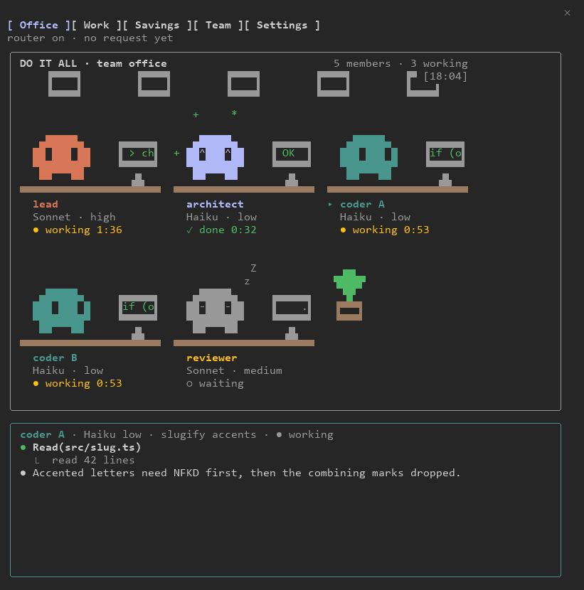
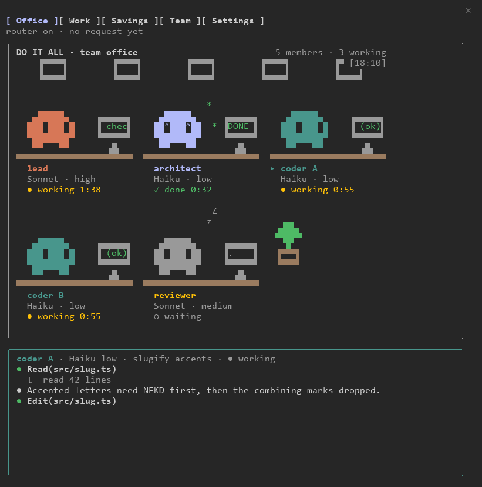

# Do It All Claude Code

[](https://github.com/ggreing/do-it-all-claude-code/actions/workflows/ci.yml)


[](LICENSE)
[](docs/measurements/decision213-fair-remeasure.md)

[English](README.md) · [한국어](README.ko.md) · [日本語](README.ja.md) · [简体中文](README.zh-CN.md)

If you run Claude Code on Opus or Sonnet, the main session does almost everything itself, including
edits that a much cheaper model would get right. This project is a Claude Code plugin plus a small local
daemon that changes that. For each request it decides whether the main session should just do it, or
hand the work to a few subagents running on cheaper models while the main session plans and checks.

> **At a glance** (30 tasks, 20 of them from SWE-bench Verified; Sonnet 5.5 main session; one run each; [details](docs/measurements/decision213-fair-remeasure.md))
> - A passed task cost 12% less than with plain Claude Code. 24 of 30 passed against 22, a gap within run-to-run variance.
> - Where the main session did the work itself, it cost about the same as plain Claude Code.
> - It is slower: on the bench's own tasks the team took 65% longer, since each hand-off starts a worker and runs the checks.

Measurements, and how we made them, are in [docs/measurements](docs/measurements/).

<p align="center"></p>

The CLI and package are called `do-it-all-claude-code`.

## How it works

The plugin forwards Claude Code's hook events to a daemon on `127.0.0.1`. When you send a prompt, the
daemon sizes it up with plain rules (no model call) and tells the main session, which we call the lead,
what to do: handle it directly, or delegate to a team.

Small things (a typo, a one-line fix) stay with the lead. Anything bigger is delegated if the lead is an
Opus-class or Sonnet model, or if the router can't tell which model it is. A Haiku lead keeps L1 work for
itself, since its workers would run the same model anyway. When the rules can't tell how big a request
is, it goes to a small team and the lead decides which roles it actually needs (a Haiku lead gets a short
rubric and decides for itself).

Workers start on the cheapest rung that usually works (Haiku at low effort for coders) and move up when
they fail: two misses in a row, two rejections from a reviewer or tester, or the lead asking for it. A
worker that keeps getting "easy" verdicts from a reviewer moves back down. After three raises the user is
asked.

When a worker finishes, the daemon runs the project's build, typecheck, lint and tests in that working
tree and checks that the worker stayed inside the files it was given. Everything goes into one local
SQLite file: what was planned, what happened, what it cost.

If the daemon isn't running, Claude Code behaves as if the plugin weren't there. The one exception is
router workers: they can only write while the daemon is up, so they never edit outside their scope.

## Getting started

You need Node 24.5+, Claude Code 2.1.325 or newer, and — on Windows — Git Bash (Claude Code itself
requires it).

On Windows, run Claude Code in **Windows Terminal** — the classic console window can't draw the team office
characters (they show as a list). Make it the default: Windows Terminal → Settings → Startup → Default
terminal application → Windows Terminal (or Windows Settings → System → Advanced (For developers on older versions) → Terminal); PowerShell
then opens inside it.

There are two ways in.

**One command (npm).** Installs the plugin and a status line, starts the daemon, and routes on your Claude
subscription by default:

```
npx do-it-all-claude-code setup
```

(or `npm i -g do-it-all-claude-code`, then `do-it-all-claude-code setup`). Then run `claude`; `/office demo`
previews the team office.

**Inside Claude Code.** If you would rather start from a session:

```
/plugin marketplace add ggreing/do-it-all-claude-code
/plugin install do-it-all-claude-code@do-it-all
/do-it-all-setup
```

The first two install the plugin; `/do-it-all-setup` installs the engine into your router home and starts the
daemon.

The daemon starts itself when a Claude Code session starts (`do-it-all-claude-code config set autoStart off`
turns that off), and `do-it-all-claude-code doctor` checks the setup if something looks off. From source
(contributors): clone, `npm ci`, then `node packages/cli/src/index.ts setup`.

Other commands you'll probably use:

| Command | What it does |
|---|---|
| `status`, `stop` | show or stop the daemon |
| `mode subscription\|api\|direct\|proxy` | switch modes (below) |
| `policy show\|accept` | review a project's `.do-it-all-claude-code/policy.json` before it takes effect |
| `data export`, `data purge` | export or delete what the router has recorded |
| `uninstall` | undo what `init` did; your data folder stays |

## Subscription or API key

By default it runs on your Claude subscription. In that mode there's no proxy and the router never reads
or stores your subscription credentials; Claude Code talks to Anthropic exactly as before.

With an API key, `do-it-all-claude-code init --mode api` puts a small local proxy in front of the API. It records
the real token cost of every call and applies daily budgets — $100 per day per local token and $300 per day
in total by default. Each request holds its worst case (its prompt size and `max_tokens` at the model's
highest rates) against those caps until it finishes, and does not start when that would not fit. Even so,
the hold covers only the request body: content the API fetches for itself — files referenced by id, images
by URL, and server tools such as web search — is charged when the call settles, so a day can still end a
little over the cap. The key itself lives only in the OS keychain. If the proxy ever gets in your way, `do-it-all-claude-code mode direct`
bypasses it and `do-it-all-claude-code mode proxy` puts it back.

**Local TLS.** In API-key mode Claude Code reaches the proxy over `https://127.0.0.1:<port>` with a
certificate only this router holds — made with `openssl`, good for `127.0.0.1` and `localhost` only and
unable to vouch for any other site, and kept readable by you alone in the router home — which Claude Code
trusts through `NODE_EXTRA_CA_CERTS` in its settings. The certificate is renewed before it expires, and
Claude Code sessions that were open during a renewal need a restart; `doctor` says when. If another program
takes the proxy's port while the proxy is down, it cannot complete the TLS handshake, so neither the local
token nor a prompt reaches it. If you already set `NODE_EXTRA_CA_CERTS` yourself (say a corporate CA), the router
writes a bundle of your certificates and its own into Claude Code's settings so your CA stays trusted;
`mode direct`, `mode subscription` and `uninstall` put your own value back, and `doctor` offers to point
your shell variable at the bundle too. Without `openssl` the proxy stays on plain HTTP with the same request
checks, and `doctor` says so.

**Behind a corporate proxy.** The proxy reaches the API through whatever proxy your environment names — the
first of `https_proxy`, `HTTPS_PROXY`, `http_proxy` and `HTTP_PROXY` (the order Claude Code uses), with
`NO_PROXY` honoured. It uses Node's built-in proxy support (Node 24.5 or later), so HTTPS goes through a
CONNECT tunnel and the API's certificate is still verified end to end. Any credentials in the proxy URL go
only to the proxy and never appear in logs, errors or `doctor`. A TLS-inspecting proxy needs its root
certificate trusted by Node, for example through `NODE_EXTRA_CA_CERTS`. SOCKS is not supported, and a proxy
setting the router cannot use stops it from starting rather than quietly going around the proxy.

In the other direction, Claude Code would otherwise send its own requests for the local proxy at
`127.0.0.1:<port>` (local token included) through your corporate proxy too. So when a proxy is set,
`do-it-all-claude-code init --mode api` and `mode api` add `127.0.0.1` and `localhost` to `NO_PROXY` in Claude
Code's settings, keeping your own entries; `mode direct`, `mode subscription` and `uninstall` remove only
what they added. `do-it-all-claude-code doctor` checks both directions.

## Workers and permissions

Router workers run Claude Code's normal tools behind a guard. The guard refuses writes outside a worker's
scope, anything touching credential files or the router's own folder, and commands outside a small
allowlist. It doesn't approve Bash on your behalf: a worker's `npm test` goes through your normal Claude
Code permission rules. To let workers build and test without being asked each time:

```
claude --allowedTools "Bash(npm test)" "Bash(npm run *)"
```

The full list of what's refused, and why, is in [docs/worker-permissions.md](docs/worker-permissions.md).

## Your data

Everything stays in one SQLite file on your machine, and the router makes no network calls of its own,
apart from the optional update check (see Updates below).
By default it doesn't keep your prompts or the text of what workers report, only ids, sizes, outcomes and
costs. If you want prompts kept for your own analysis, turn on `recordPrompts`; turning it off again
deletes them at the next daemon start. Event records are kept for 30 days.

## Updates

The router can tell you when a newer version is out — off unless you turn it on. `do-it-all-claude-code init`
asks (press Enter for yes); later, `do-it-all-claude-code update on` turns it on, `off` turns it off, and
`check` looks right now whatever the setting and prints what you have against the newest release. An existing
install stays off until you turn it on, and `doctor` offers it meanwhile. When on, the daemon checks GitHub's
public release list at most once a day. GitHub sees an ordinary web request from your machine — your IP
address and a generic client name — and nothing else: no prompts, no usage, no identifiers. A newer version
then shows in the status line (` | update 0.4.0`) and as a one-line note at the start of a session, only to
you and at most once a day per version. Nothing updates itself.

## The team office

Type `/office` in Claude Code and a panel opens beside the chat that shows the team at work. On a wide
terminal it also opens by itself when a request's first worker starts (`config set officeAutoOpen off` stops
that). The panel has no text input: the settings it offers change with Enter and are written only after you
confirm; anything that needs typing is shown with the CLI command that changes it.

<p align="center"></p>

*The tabs, shown here with sample data (not measurements).*

| Tab | Its first line answers | Below that |
|---|---|---|
| Office | who is on the team and what each one is doing | each member at a desk with model and effort; the picked member's session, the way Claude Code draws its own |
| Work | what is running now, and how today went | recent requests, running ones first. Open one for its timeline (plan, workers, verify, review), the files it changed with `+`/`-` counts, the tests, step changes, time and cost |
| Savings | what was spent, measured, and how much of your 5-hour and 7-day limits is used | spend per hour or day as bars. Then, apart and labelled as estimates: the workers' tokens priced at the lead model's rate, with its assumptions, and the holdout comparison of real requests with its sample counts. A comparison with too few requests says how many are still needed and shows no difference |
| Team | the profile, and how the roles did | each role's pass rate as a bar, its average cost and time and its step changes, the model and effort per level and where each comes from; the latest step changes; the triage's hit rate at the bottom |
| Settings | the profile, and how many settings are your own | each setting the panel can change, with the value in effect and where it comes from (default, profile, your own, the project's); problems one line each; the verify commands, role files and `teams.yaml`, shown with the command that edits them |

Click the panel, or press ctrl+x then tab, to give it the keyboard; Esc returns to the prompt. `o`, `w`, `s`, `t`
and `c` switch tabs, ↑/↓ and Tab walk the buttons, and Enter presses one. In Office, 1–9 pick a member, ←/→ move
the highlight, and `v` shows that member's transcript in the main view. In Work, Enter opens a request and `b`
goes back. In Savings and Team, `p` steps the period: 24 hours, 7 days, 30 days. In Settings, Enter steps the
value of the row you are on and the change waits, shown as old → new; `a` asks before writing (`y` writes,
`n` not now) and `x` drops what waits. A value that takes effect only at the next start or session says so.

`/office demo` shows a preview with made-up members, and `/office clear` empties the panel. The panel never
shows prompt text. While the daemon isn't running each tab says so in one line, and Office still shows the team
from Claude Code's own events, without the router's numbers. In the classic Windows console the office is a
list, drawn with marks that console shows one cell wide.

If the panel doesn't behave:

- **Keys land in the prompt after you narrow the window.** When the terminal gets too narrow for the panel beside
  the chat (under 110 columns), Claude Code moves the panel above the prompt and gives the keyboard back to the
  prompt. Press ctrl+x then tab to give it to the panel again.
- **The panel above the prompt is only a few rows high.** Claude Code keeps the height you last gave a plugin's
  panel, for every plugin's panel, and it wins over the height the panel asks for. Press ctrl+x then tab, then
  ctrl+x ↑ to make it taller.
- **A list where the characters should be.** The default console window (Windows PowerShell, Command Prompt)
  draws the characters' marks two cells wide, which breaks the drawing, so the office shows a list there. Open
  Claude Code in Windows Terminal; [Getting started](#getting-started) says how to make it the default terminal.

`do-it-all-claude-code config set office off` turns the panel off for sessions started after that. It needs
Claude Code 2.1.325 or newer. Versions before 0.5.0 had a browser dashboard instead; it's gone.

## Settings and profiles

A profile moves several settings at once. There are three, and `balanced` is what you get unless you pick
another:

| | save | balanced | quality |
|---|---|---|---|
| Delegation starts at | as balanced | L1 for an Opus or Sonnet lead, L2 for a Haiku lead | L2: the lead does L1 work itself |
| L2 team | two coders and a tester; the lead reviews | architect, two coders, reviewer, tester | the same team, each one rung higher |
| L3 team | coders start on Sonnet | coders start on Opus | coders on Opus; the architect and reviewer at its highest effort |
| After "easy" verdicts | a worker moves back down | a worker moves back down | it stays where it is |
| Budget of one request | 0.6 of the default | the default | 1.5 of the default |

Only `balanced` has been measured (see [docs/measurements](docs/measurements/)). `save` and `quality` move
the same settings one way or the other and have not been measured yet, so we don't know what they do to cost
or to the pass rate.

To change it, open the team office's Settings tab, move to a value and press Enter to step through its
choices; `a` then `y` applies what you changed, and `x` drops it. Or use the CLI:

```
do-it-all-claude-code config set profile quality
```

A value you set yourself stays above the profile: a budget (`budgetsUsd`), where delegation starts
(`delegateFrom`), `stepDown`, or teams in a `teams.yaml`. The Settings tab shows each value with where it
comes from (the default, the profile, your own setting, or the project's file), and
`do-it-all-claude-code config set <key> default` takes your own value away again. Both ways are checked the
same and land in the same history (`do-it-all-claude-code config history`).

Two settings are new in 0.5.0:

| Key | What it does | Default |
|---|---|---|
| `officeAutoOpen` | the team office opens by itself when a request's first worker starts | on |
| `autoStart` | the daemon starts when a Claude Code session starts, if it isn't running | on |

Role files, the full `teams.yaml` and a project's verify commands need an editor, so the panel shows them
with the command that opens them (`role edit`, `preset edit`).

## Checking that delegation still pays off

About one in ten requests that would be delegated is handled by the lead on purpose, so there's
something to compare against. Out of the box the router only reports what it sees; it won't switch
anything off by itself unless you set `autoRelease` to on. Set `holdoutRate` to 0 if you'd rather not
have the comparison at all.

## What doesn't work well yet

The checks after a worker finishes are the project's own tests, so a fix that's wrong in a way the tests
don't cover will still pass. When that happens the lead can send the work back up a rung, but it has to
notice first.

"Accepted" in the Savings tab's comparisons means nobody reverted the change, asked for it again, or complained within
the next couple of prompts. That's a ceiling on how often the work was good, not a measurement of it.

The automatic switch-off is meant to catch delegation that has become clearly more expensive, not to
fine-tune. With the sample sizes involved it can't tell a 25% loss from noise.

This is a pre-release. Commands and defaults may still change.

## Contributing and security

See [CONTRIBUTING.md](CONTRIBUTING.md). Please report security issues privately as described in
[SECURITY.md](SECURITY.md), which also lists what the guard can't protect against.

## License

Business Source License 1.1 (BUSL-1.1). You may use it, at work too, to build and run your own software; selling it, or a paid product or service built mainly on it, needs a commercial license from the author. Each version becomes Apache-2.0 four years after it is published. Versions up to 0.4.0 were released under Apache-2.0 and stay so. See [LICENSE](LICENSE) and [NOTICE](NOTICE).
