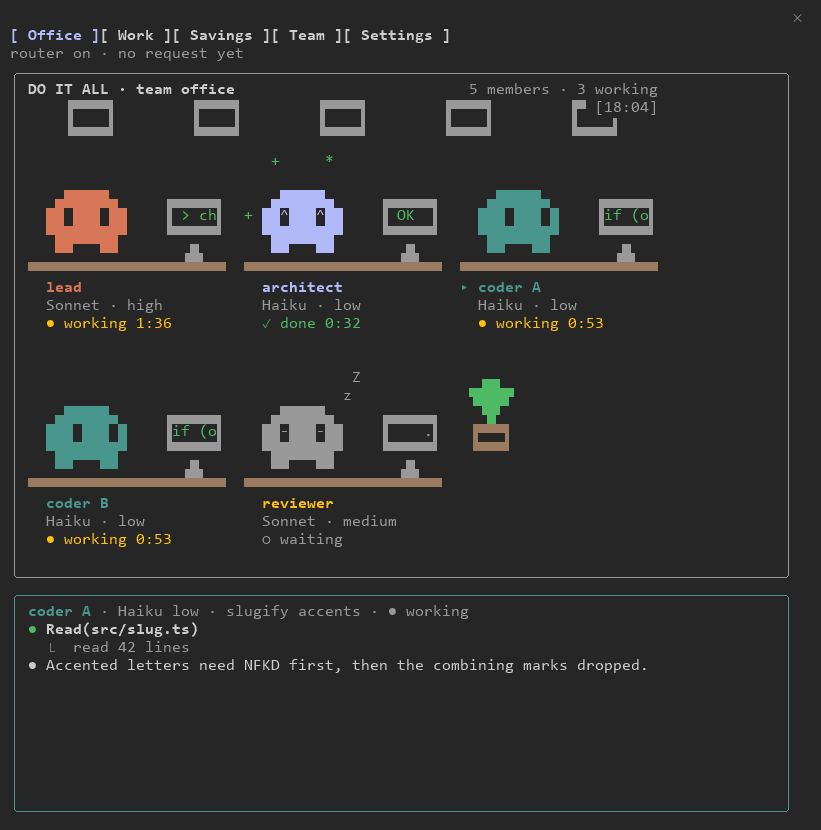
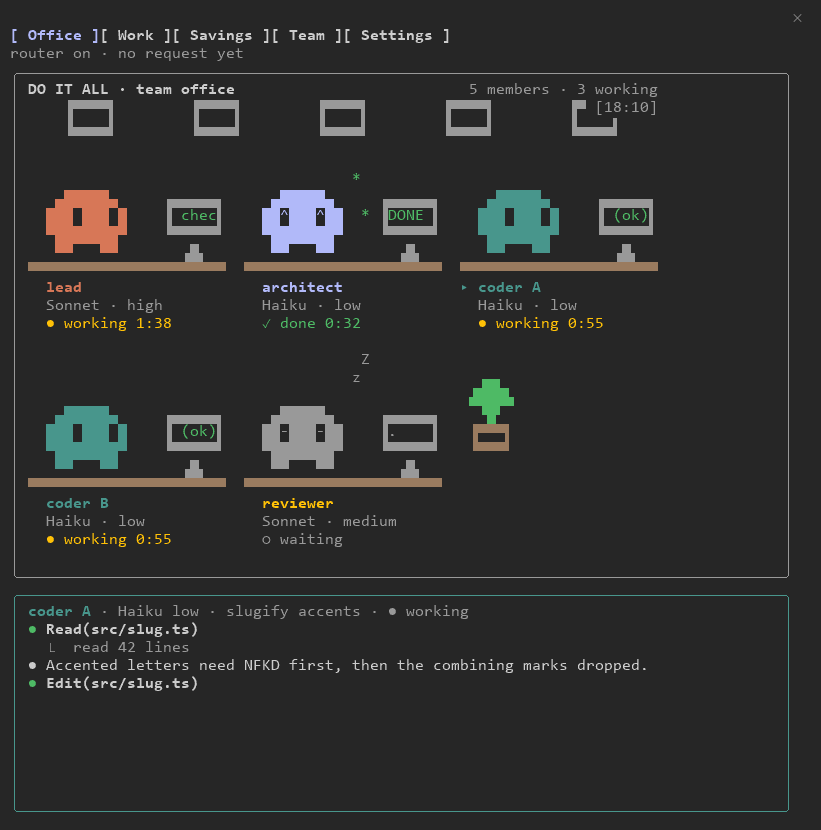

# Do It All Claude Code

[](https://github.com/ggreing/do-it-all-claude-code/actions/workflows/ci.yml)


[](LICENSE)
[](docs/measurements/decision230-234-subscription.md)

[English](README.md) · [한국어](README.ko.md) · [日本語](README.ja.md) · [简体中文](README.zh-CN.md)

用 Opus 或 Sonnet 跑 Claude Code 时，主会话几乎什么都自己做，连便宜得多的模型也能改对的改动也不例外。
这个项目是一个 Claude Code 插件加一个小的本地守护进程，用来改变这一点。每来一个请求，它就决定主会话是
直接处理，还是去协调几个子代理。每个子代理跑在适合它那部分的模型上：常规的活儿用小模型，难的部分用 Opus。
所有结果都由路由器检查。

> **一览**（一天之内、在一台机器上用订阅测得；Sonnet 5.5 主会话，对比直接用 Opus 5.5 的 Claude Code；成本是 Claude Code 按 API 价格给出的估算；[详情](docs/measurements/decision230-234-subscription.md#2-the-final-comparison)）
> - **功能开发**（基准自带的 10 个任务，各跑一次）：和 Opus 单独做一样，10 个全部通过，成本低 67%（$1.73 对 $5.27），用时少 25%。
> - **难缠的 bug**（SWE-bench Verified 的 5 个任务，各跑两次）：10 次里通过 5 次，和 6 次的差距在每次运行的波动范围内；成本相同（$3.22 对 $3.17）。用时少 57%，但这个差距大半来自 Opus 单独在一个任务上很慢的一次运行。让 Sonnet 会话把整个任务交给一个 Opus 子代理的做法，便宜 $0.90。这些项目的测试在测量用的机器上启动不了，所以 10 次里路由器只有 2 次能检查结果。
> - 样本很小：功能任务只跑了一次；bug 任务即使配置不变，每次运行的通过数也会相差多达三个。没有跑 Sonnet 单独的对照。
> - 主会话推荐用 Sonnet：主控负责协调，难的活儿由路由器交给 Opus。

测量结果和测法都在 [docs/measurements](docs/measurements/)。

<p align="center"></p>

CLI 和软件包都叫 `do-it-all-claude-code`。

## 工作原理

插件把 Claude Code 的挂钩事件转发给 `127.0.0.1` 上的守护进程。你发出一个提示，守护进程不调用模型、只用
规则估一下请求的大小，然后告诉主会话（我们叫它「主控」）该怎么办。

**主控负责协调。** 只有最小的改动（一个拼写错误、一行默认值）由主控自己做，更大的活儿交给子代理。主控的第一
眼只和路由器一起判断请求的大小和难度，不去追查原因，也不自己起草修复，因为它的每次调用都要按主控模型的价格
把整个上下文重读一遍。规则判断不出大小的请求，会送给一个小团队，需要哪些角色由主控来定。工作者可以比主控
更强：Sonnet 主控可以把难的部分交给 Opus 编码者。

**每个子任务有自己的难度。** 主控不只按文件、也按难度拆分请求，给每一部分标上 routine、moderate 或 hard。
请求看起来像难缠的 bug（有回溯、回归、竞态）时，路由器会把下限调高。这样，难的修复由强模型来做，变更记录
条目同时由 Haiku 来写。

**工作者从哪里开始，取决于路由器能不能检查它的结果。** 每个仓库和提交，路由器会在后台确认一次项目的测试在
这个环境里能不能启动。能启动，编码者就从 Haiku 的 low 开始（难的部分从 Sonnet 的 medium），只有没达标才往上
走。不能启动，错了也看不出来，所以改源代码的编码者直接在 Opus 的 high 上做一次。属于哪种情况，团队办公室里
会显示「checkable」（可检查）或「not checkable」（不可检查）。

**工作者在模型和 effort 的表上移动。** 模型有 Haiku、Sonnet、Opus，打开 `fableOptIn` 还有 Fable；effort 从
low 到 max。失败时按测过的大步往上走：连续两次没达标、被审查者或测试者拒绝两次，或者主控要求。审查者接连
判定「有余量」时按小步往下走，先降 effort，再降模型。升了三次还不行，就问用户。还没测过成本的格子，在团队
办公室里标为「est.」。

**工作者诊断，路由器验证。** 拿到 bug 的编码者先复现，再追查原因，在原因所在处修复，并且只跑和自己改动相关的
测试。工作者做完后，守护进程在那个工作目录里跑项目自己的构建、类型检查、lint 和测试，并检查工作者只改了
交给它的文件范围。主控不再重跑检查，而是相信这个结果。计划了什么、实际发生了什么、花了多少，全都记在一个
本地 SQLite 文件里。

守护进程没在跑时，Claude Code 的表现就跟没装插件一样。唯一的例外是路由器的工作者：它们只有在守护进程开着
时才能写入，所以不会改到自己范围之外。

## 开始使用

需要 Node 24.5 以上、Claude Code 2.1.325 或更新版本，Windows 上还要有 Git Bash（Claude Code 本身就要求它）。

在 Windows 上，请在 **Windows Terminal** 中运行 Claude Code。默认的控制台窗口画不出团队办公室的字符（会显示成
一个列表）。设为默认：Windows Terminal → 设置 → 启动 → 默认终端应用程序 → Windows 终端（或 Windows 设置 →
系统 → 高级（旧版本为开发者选项）→ 终端）。这样打开 PowerShell 也会在 Windows Terminal 里打开。

有两种方式。

**一条命令（npm）。** 装好插件和一行状态栏，启动守护进程，默认在你的 Claude 订阅上路由：

```
npx do-it-all-claude-code setup
```

（或先 `npm i -g do-it-all-claude-code`，再 `do-it-all-claude-code setup`。）然后运行 `claude`；`/office demo`
可以预览团队办公室。主会话推荐用 Sonnet：主控只负责协调，难的活儿由路由器交给 Opus。

**在 Claude Code 里。** 如果你想从会话里开始：

```
/plugin marketplace add ggreing/do-it-all-claude-code
/plugin install do-it-all-claude-code@do-it-all
/do-it-all-setup
```

前两行安装插件，`/do-it-all-setup` 把引擎装进路由器主目录并启动守护进程。

守护进程会在 Claude Code 会话开始时自行启动（用 `do-it-all-claude-code config set autoStart off` 关闭）。要是哪里
不对劲，用 `do-it-all-claude-code doctor` 检查。从源码（贡献者）：克隆后 `npm ci`，再
`node packages/cli/src/index.ts setup`。

你大概会常用这些命令：

| 命令 | 作用 |
|---|---|
| `status`, `stop` | 查看或停止守护进程 |
| `mode subscription\|api\|direct\|proxy` | 切换模式（见下文） |
| `policy show\|accept` | 在项目的 `.do-it-all-claude-code/policy.json` 生效前先查看 |
| `data export`, `data purge` | 导出或删除路由器记录的内容 |
| `uninstall` | 撤销 `init` 做的事（数据文件夹保留） |

## 用订阅还是用 API 密钥

默认用你的 Claude 订阅。这种模式下没有代理，路由器既不读取也不保存你的订阅凭据，Claude Code 照旧直接和
Anthropic 通信。

要用 API 密钥，运行 `do-it-all-claude-code init --mode api`，它会在 API 前面放一个小的本地代理。代理记录每次调用
的真实令牌成本，并施加每天的预算：默认是每个本地令牌每天 $100、总共每天 $300。每个请求会按最坏情况（提示
大小和 `max_tokens` 以该模型的最高费率计价）占住这些上限，直到请求结束；放不下时就不开始该请求。不过这种
占用只覆盖请求正文：API 自己去取的内容（用 ID 引用的文件、用 URL 引用的图片，以及网页搜索这类服务器工具）
不在正文里，只有在调用结算时才计费，所以一天仍可能略微超出上限。密钥本身只放在操作系统的密钥库里。要是代理碍事，`do-it-all-claude-code mode direct` 可以绕过它，`do-it-all-claude-code mode
proxy` 再把它放回来。

**本地 TLS。** 在 API 密钥模式下，Claude Code 通过 `https://127.0.0.1:<port>` 连接代理，使用只有这个路由器
持有的证书。它用 `openssl` 生成，只对 `127.0.0.1` 和 `localhost` 有效，无法为其他站点背书，放在路由器主目录
里、只有你能读取。Claude Code 通过设置里的 `NODE_EXTRA_CA_CERTS` 信任这张证书。证书会在到期前续期，续期时
仍开着的 Claude Code 会话需要重启；`doctor` 会告知时机。若别的程序在代理停止时占住它的端口，它无法完成
TLS 握手，所以本地令牌和提示都不会送到那里。如果你自己已经在用
`NODE_EXTRA_CA_CERTS`（比如公司 CA），路由器会把你的证书和它自己的证书打成一个捆绑包写进 Claude Code 的
设置，让公司 CA 继续受信任；`mode direct`、`mode subscription` 和 `uninstall` 会还原你原来的值，`doctor`
还会建议把你的 shell 变量也指向这个捆绑包。没有 `openssl` 时，代理会保持相同的请求检查、改用明文 HTTP，
`doctor` 会说明这一点。

**在公司代理后面。** 代理通过你环境里指定的代理访问 API：`https_proxy`、`HTTPS_PROXY`、`http_proxy`、
`HTTP_PROXY` 中第一个设置的那个（Claude Code 使用的顺序），并尊重 `NO_PROXY`。它用 Node 内置的代理支持
（Node 24.5 及以上），所以 HTTPS 走 CONNECT 隧道，API 的证书仍然端到端验证。代理 URL 里的凭据只发给代理，
不会出现在日志、错误或 `doctor` 里。会解密 TLS 的代理需要让 Node 信任它的根证书，例如通过
`NODE_EXTRA_CA_CERTS`。不支持 SOCKS；遇到路由器无法使用的代理设置，它会停止启动，而不是悄悄绕过代理。

反过来，若不处理，Claude Code 发给 `127.0.0.1:<port>` 本地代理的自身请求（含本地令牌）也会经过你的
公司代理。所以设置了代理时，`do-it-all-claude-code init --mode api` 和 `mode api` 会把 `127.0.0.1` 和 `localhost`
加到 Claude Code 设置的 `NO_PROXY` 里（保留你自己的条目）；`mode direct`、`mode subscription` 和
`uninstall` 只移除它们自己加的那部分。`do-it-all-claude-code doctor` 会检查两个方向。

## 工作者与权限

路由器的工作者照常用 Claude Code 的工具，只是前面隔着一道守卫。守卫会拒绝写到范围之外、碰凭据文件或路由器
自己的文件夹、以及小许可清单之外的命令；放到后台运行或超时设置超过 180 秒的命令、装到项目之外的
`pip install`，也会被拒绝。它不会替你批准 Bash：工作者的 `npm test` 仍走你平常的 Claude Code
权限规则。想让工作者构建和测试时不必每次都问，就这样允许：

```
claude --allowedTools "Bash(npm test)" "Bash(npm run *)"
```

什么会被拒绝、为什么，完整清单在 [docs/worker-permissions.md](docs/worker-permissions.md)（英文）。

## 你的数据

所有记录都留在你机器上的一个 SQLite 文件里，路由器不会自己发起任何网络调用，只有可选的更新检查例外（见下文
「更新」）。默认不保存你的提示，也不保存
工作者报告的文字，只留 id、大小、结果和成本。如果你想留下提示做自己的分析，打开 `recordPrompts`；再关掉时，
会在守护进程下次启动时把它们删掉。事件记录保留 30 天。

## 更新

路由器可以在有新版本时告诉你——除非你打开，否则它是关的。`do-it-all-claude-code init` 会询问（按 Enter
表示打开）；之后用 `do-it-all-claude-code update on` 打开、`off` 关闭，`check` 则不管设置如何都立即检查，
并显示你当前的版本和最新发布。已有的安装在你打开前一直是关的，其间 `doctor` 会建议打开。打开后，守护进程
每天最多检查一次 GitHub 的公开发布列表。GitHub 只看到来自你机器的一次普通网络请求（你的 IP 地址和一个通用
的客户端名称），不会发送别的：没有提示、没有用量、没有身份信息。有新版本时，会在状态栏（` | update 0.4.0`）
和会话开始时的一行提示里显示，只给你看，而且每个版本每天最多一次。它不会自动更新。

## 团队办公室

在 Claude Code 里输入 `/office`，对话旁边会打开一个面板，显示团队的工作情况。终端够宽时，请求的第一个工作者
启动时它也会自己打开（`config set officeAutoOpen off` 可以关掉这一点）。面板没有文字输入框：面板能改的设置用
Enter 切换取值，确认之后才写入；需要输入文字的值，会和修改它的 CLI 命令一起显示。

<p align="center"></p>

*标签页里的数字是示例数据（不是测量值）。*

| 标签页 | 第一行回答的问题 | 下面是什么 |
|---|---|---|
| 办公室 | 团队里有谁、每个人在做什么 | 每个成员坐在桌前，显示模型和努力级别；选中成员的会话，画法和 Claude Code 自己的一样 |
| 工作 | 现在在跑什么、今天情况如何 | 最近的请求，进行中的排在最上面。打开一个可以看到时间线（计划、工作者、验证、评审）、改动的文件和 `+`/`-` 行数、测试、阶梯变化、时间和成本 |
| 节省 | 实际花了多少（测量值），以及 5 小时、7 天用量上限用了多少 | 按小时或按天的花费柱状图。下面另外列出两项比较，并标明是估算：一项是把工作者的 token 按主控模型的价格计算（附带假设），另一项是用真实请求做的留出对照（附带样本数）。请求不够的比较只说明还差多少个，不显示差值 |
| 团队 | 配置档，以及各角色的表现 | 每个角色的通过率柱、平均成本和时间、阶梯变化，各级别的模型和努力级别及其来源；最近的阶梯变化；最下面是分诊的命中率 |
| 设置 | 配置档，以及有几项是你自己设定的 | 面板能改的每项设置，显示实际生效的值和来源（默认、配置档、你自己设定、项目）；问题每条一行；验证命令、角色文件和 `teams.yaml` 和编辑它们的命令一起显示 |

点击面板，或者按 ctrl+x 再按 tab，键盘就交给面板；Esc 回到提示符。`o`、`w`、`s`、`t`、`c` 切换标签页，↑/↓ 和
Tab 在按钮之间移动，Enter 按下按钮。在办公室里，1–9 选成员，←/→ 移动高亮，`v` 在主视图里显示该成员的记录。
在工作里，Enter 打开一个请求，`b` 返回。在节省和团队里，`p` 依次切换时段：24 小时、7 天、30 天。在设置里，
Enter 切换当前行的取值，改动以“原值 → 新值”显示并等待；`a` 在写入前确认（`y` 写入，`n` 暂不），`x` 丢弃等待中的
改动。下次启动或下次会话才生效的值会标明。

`/office demo` 用虚构的成员显示预览，`/office clear` 清空面板。面板从不显示提示词内容。守护进程没有运行时，
每个标签页用一行说明，办公室仍然根据 Claude Code 自己的事件显示团队，只是没有路由器的数字。在 Windows 传统
控制台里，办公室显示为列表，只用该控制台画成一格宽的符号。

面板表现不对时：

- **把窗口调窄后，按的键进了提示符。** 终端窄到放不下对话旁边的面板时（不到 110 列），Claude Code 会把面板移到
  提示符上方，并把键盘交还给提示符。按 ctrl+x 再按 tab，键盘就回到面板。
- **提示符上方的面板只有几行高。** Claude Code 会把你最后一次给插件面板定的高度用在所有插件的面板上，并且优先于
  面板自己请求的高度。按 ctrl+x 再按 tab，然后按 ctrl+x ↑ 把它调高。
- **该显示角色的地方显示成了列表。** 默认的控制台窗口（Windows PowerShell、命令提示符）会把角色的符号画成两格宽，
  画面会乱掉，所以办公室在那里显示为列表。请在 Windows Terminal 里打开 Claude Code；怎样把它设为默认终端，见
  [开始使用](#开始使用)一节。

运行 `do-it-all-claude-code config set office off` 后，之后启动的会话不再显示面板。它需要 Claude Code 2.1.325
或更新的版本。0.5.0 之前版本里的浏览器仪表板已经移除。

## 设置与配置档

配置档一次改动好几项设置。一共三种，不选的话就是 `balanced`。

| | save（节约） | balanced（均衡） | quality（质量） |
|---|---|---|---|
| 从哪个级别开始委派 | 与 balanced 相同 | 不论主控是什么模型，都从 L1 | L2：L1 的活儿主控自己做 |
| L2 团队 | 两个编码者和一个测试者，审查由主控来做 | 架构师、两个编码者、审查者、测试者 | 与 balanced 相同 |
| 工作者从哪里开始 | 低一档 | 看难度，以及路由器能不能检查结果 | 高一档 |
| 接连得到「有余量」判定后 | 工作者降一档 | 工作者降一档 | 保持不变 |
| 单个请求的预算 | 默认值的 0.6 倍 | 默认值 | 默认值的 1.5 倍 |

只有 `balanced` 做过测量（见 [docs/measurements](docs/measurements/)）。`save` 和 `quality` 是把同样的设置往一边挪，还没有
测量过，所以它们对成本和通过率的影响目前不清楚。

要修改，打开团队办公室的设置标签页，移到某个值上按 Enter 在选项之间切换；按 `a` 再按 `y` 应用改动，按 `x`
放弃。也可以用 CLI：

```
do-it-all-claude-code config set profile quality
```

你自己设定的值优先于配置档：预算（`budgetsUsd`）、开始委派的级别（`delegateFrom`）、`stepDown`，以及
`teams.yaml` 里的团队。设置标签页会显示每个值的来源（默认值、配置档、你自己的设置、项目文件），运行
`do-it-all-claude-code config set <key> default` 可以去掉你自己的值。两种方式经过同样的检查，并记入同一份
历史（`do-it-all-claude-code config history`）。

0.5.0 新增了两项设置：

| 键 | 作用 | 默认值 |
|---|---|---|
| `officeAutoOpen` | 请求的第一个工作者启动时，团队办公室自己打开 | on |
| `autoStart` | Claude Code 会话启动时，如果守护进程没在运行就启动它 | on |

角色文件、完整的 `teams.yaml` 和项目的验证命令需要编辑器，面板只把它们和打开它们的命令（`role edit`、
`preset edit`）一起显示出来。

## 确认委派是否仍然划算

本该委派的请求里，大约每十个就有一个故意交给主控直接处理，好有个对照。开箱即用时路由器只报告它看到的情况，
除非你把 `autoRelease` 设为开，否则它不会自己关掉任何东西。要是你连对照都不想要，把 `holdoutRate` 设为 0。

## 目前还做不好的地方

工作者结束后跑的检查，归根结底是项目自己的测试。以测试覆盖不到的方式出错的修复，照样会通过。出现这种情况
时主控可以把活儿往上退一档，但得先察觉到。

如果项目的测试在你的环境里启动不了，路由器就完全检查不了工作者的结果。这时编码者在 Opus 上做一次，主控会
告诉你改了什么，以及这里没能测试。

主控的第一眼可能把工作者困在症状上。在测过的一个 bug 上，主控把编码者限制在 issue 里点名的那个文件，而修复
其实应该在另一个文件里：在路由器下六次全都失败，不用路由器时五次通过了四次。

节省标签页的比较里的「受理」指的是，在接下来的几个提示内没人撤销这次改动、没再提一次同样的请求、也没抱怨。这是「有
多大比例的工作是好的」的上限，不是对它的测量。

自动关闭是用来抓住明显变贵的委派的，不是用来精细调节的。以涉及的样本量，它分不清 25% 的损失和噪声。

这还是发布前版本，命令和默认值可能还会变。

## 贡献与安全

见 [CONTRIBUTING.md](CONTRIBUTING.md)。安全问题请按 [SECURITY.md](SECURITY.md) 所述私下报告，那里也列出了
守卫无法防护的情况。

## 许可证

Business Source License 1.1（BUSL-1.1）。用它来开发和运行你自己的软件（包括在工作中）是免费的；出售它，或提供主要依靠它的付费产品或服务，需要作者的商业许可。每个版本在发布四年后变为 Apache-2.0。0.4.0 及以前的版本以 Apache-2.0 发布，保持不变。见 [LICENSE](LICENSE) 和 [NOTICE](NOTICE)。
